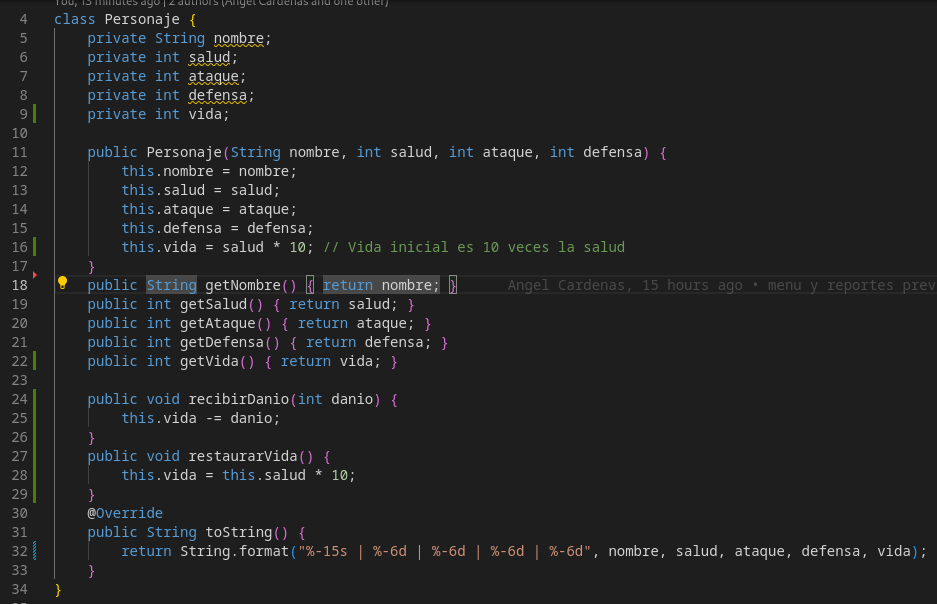
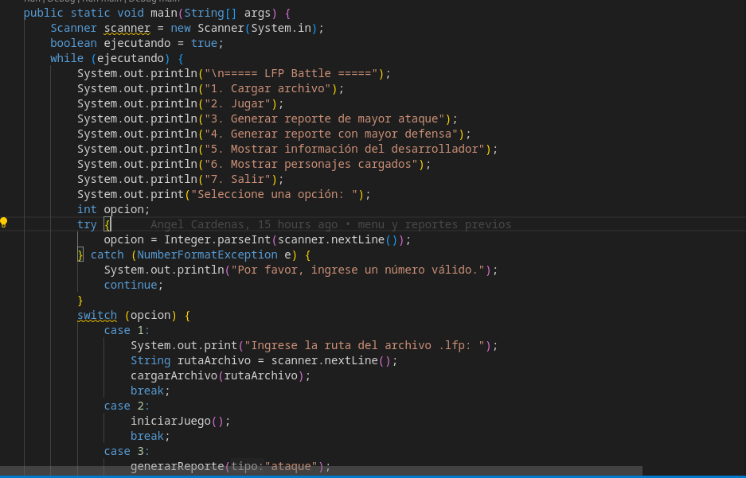
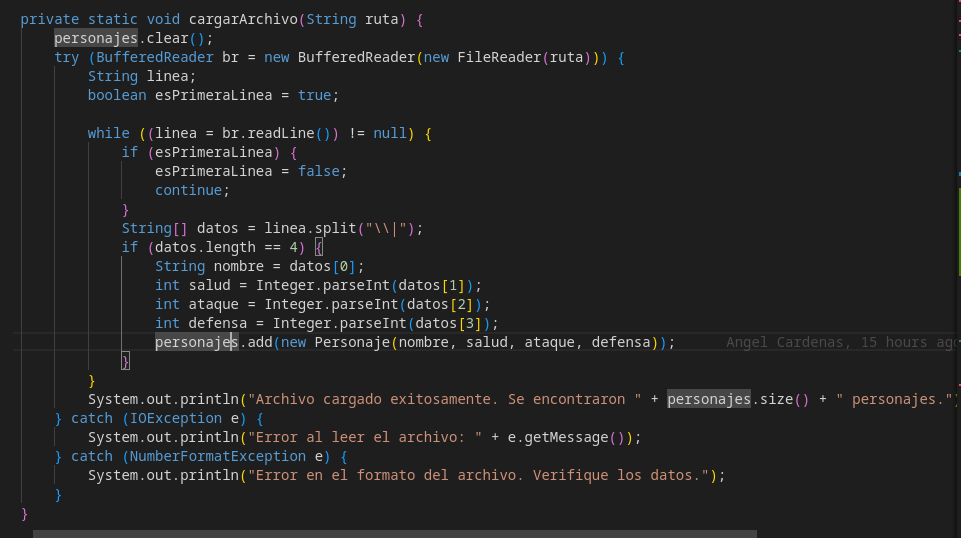
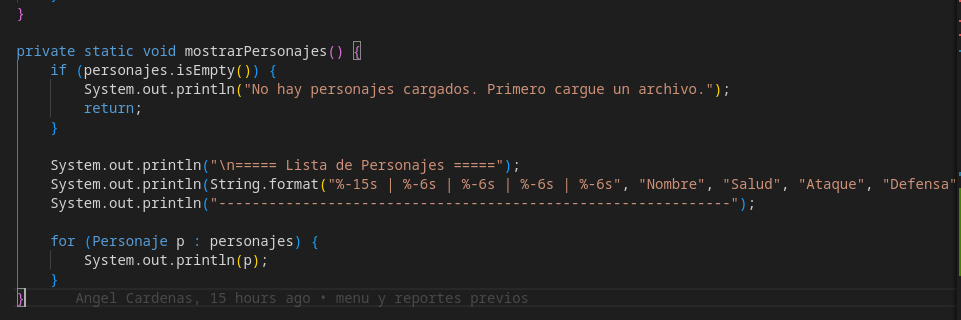
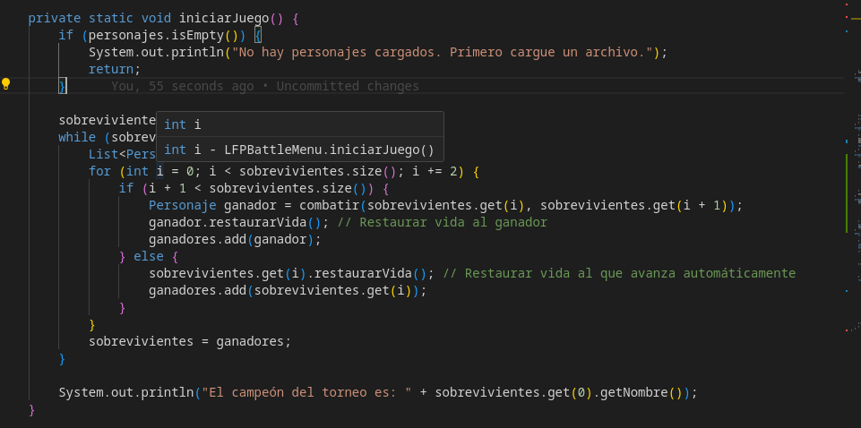
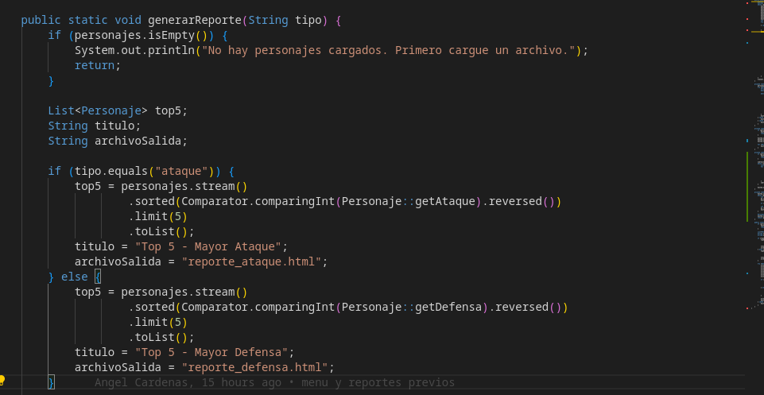
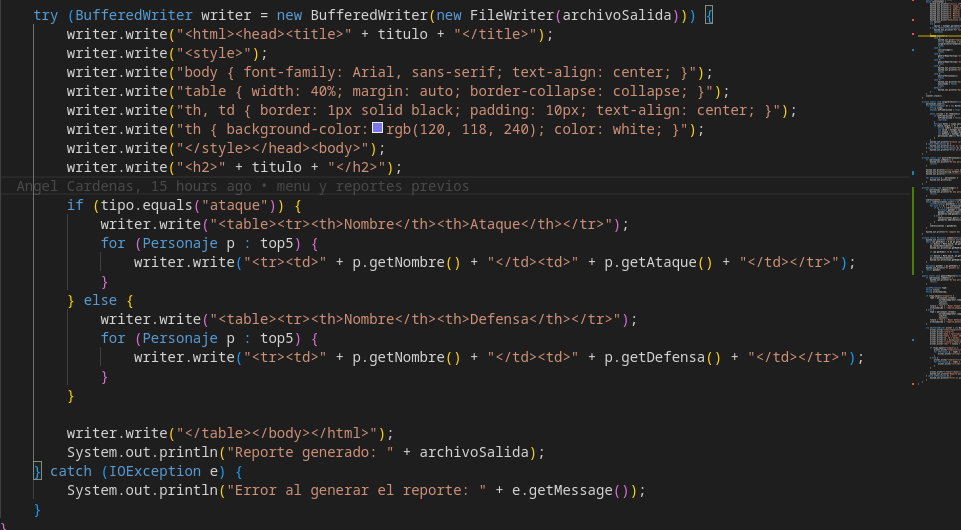

## UNIVERSIDAD DE SAN CARLOS DE GUATEMALA
### FACULTAD DE INGENIERÍA
#### LENGUAJES FORMALES Y DE PROGRAMACIÓN
#### CATEDRÁTICO: Ing. Zulma Karina Aguirre Ordoñez
#### TUTOR ACADÉMICO: Jonatan Leonel García Arana

#### Angel José Cardenas Pocón
#### CARNÉ: 202304063
#### SECCIÓN: B-

#### Guatemala, 2 de marzo del 2025

# Manual Técnico - LFP Battle

## 1. Introducción
El presente manual técnico describe la arquitectura y el funcionamiento interno del sistema *LFP Battle*, un simulador de torneo de batallas desarrollado en Java. Este documento está dirigido a desarrolladores y personal técnico que deseen comprender la estructura del código, su implementación y los requisitos necesarios para su ejecución.

El sistema carga un archivo de texto con información de personajes y simula una serie de combates eliminatorios basados en atributos como salud, ataque y defensa. Además, genera un reporte en HTML con estadísticas del torneo.

---

## 2. Objetivos del Sistema

### **Objetivo General**
Desarrollar un sistema de simulación de torneos de batalla basado en Programación Orientada a Objetos (POO), proporcionando una estructura escalable y modular en Java que permita gestionar combates y generar reportes de manera automatizada.

### **Objetivos Específicos**
- Implementar una estructura modular con clases en Java para representar personajes y sus atributos.
- Utilizar estructuras de datos dinámicas para manejar los personajes en la competencia.
- Aplicar lógica de combate mediante estructuras de control (condicionales y bucles).
- Integrar un mecanismo de lectura de archivos `.lfp` para cargar datos de personajes de forma estructurada.
- Generar reportes en formato HTML con estadísticas del torneo.
- Asegurar que el sistema sea extensible y fácil de modificar en futuras versiones.

---

## 3. Requisitos del Sistema

### **3.1. Requisitos de Software**
- **Sistema Operativo:** Windows, macOS o Linux.
- **Java Development Kit (JDK):** Versión 8 o superior.
- **Editor de Código o IDE recomendado:** IntelliJ IDEA, Eclipse o Visual Studio Code.
- **Herramienta de compilación:** Javac (incluido en el JDK).
- **Navegador Web:** Para visualizar el reporte HTML generado.

### **3.2. Requisitos de Hardware**
- **Procesador:** Mínimo Intel Core i3 / AMD Ryzen 3 o superior.
- **Memoria RAM:** 4 GB mínimo (8 GB recomendado para un mejor rendimiento).
- **Almacenamiento:** 100 MB de espacio disponible para archivos y logs.
- **Pantalla:** Resolución mínima de 1280x720.


## 4. Lògica del programa

Esta clase encapsula la lógica principal de un personaje dentro del juego, incluyendo su inicialización, manejo de vida y representación en texto. Es una parte fundamental del sistema de batallas en *LFP Battle*.



- El método `main` implementa un **menú interactivo** en consola.
- Usa un **bucle `while`** para mantener la ejecución hasta que el usuario decida salir.
- Valida la entrada del usuario con `try-catch`.
- Ejecuta diferentes funcionalidades mediante un `switch`.
- Llama a métodos clave como `cargarArchivo()`, `iniciarJuego()`, `generarReporte()` y `mostrarPersonajes()`.



La función `cargarArchivo` es un método `private` y `static` que se encarga de leer un archivo de texto, procesar su contenido y cargar una lista de objetos `Personaje`. A continuación, se detalla su funcionamiento:

## **Parámetro**
- `String ruta`: Representa la ubicación del archivo que se desea leer.

## **Flujo del método**
1. **Limpieza de la lista**  
   Se ejecuta `personajes.clear();` para vaciar la lista de personajes antes de cargar nuevos datos.

2. **Lectura del archivo**  
   Se utiliza un `BufferedReader` envuelto en un `FileReader` para leer el archivo línea por línea dentro de un bloque `try-with-resources`, lo que garantiza el cierre automático del `BufferedReader`.

3. **Omisión de la primera línea**  
   Se usa la variable `esPrimeraLinea` para saltar la primera línea del archivo (probablemente un encabezado).

4. **Procesamiento de cada línea**  
   - Cada línea se divide en partes usando `split("\\|")`, suponiendo que los datos están separados por `|`.
   - Se verifica que haya exactamente 4 elementos en la línea.
   - Se extraen los valores:
     - `nombre`: Primer campo.
     - `salud`: Convertido a `int` desde el segundo campo.
     - `ataque`: Convertido a `int` desde el tercer campo.
     - `defensa`: Convertido a `int` desde el cuarto campo.
   - Se crea un nuevo objeto `Personaje` con estos valores y se agrega a la lista `personajes`.

5. **Mensajes de estado**  
   - Se imprime la cantidad de personajes cargados correctamente.
   - Se manejan excepciones:
     - `IOException`: Error al abrir o leer el archivo.
     - `NumberFormatException`: Error si los valores numéricos no son correctos.




El método `mostrarPersonajes` es un método `private` y `static` que imprime en consola la lista de personajes cargados en el programa.

## **Flujo del método**

1. **Verificación de la lista**  
   - Se usa `personajes.isEmpty()` para verificar si la lista de personajes está vacía.
   - Si la lista está vacía, se imprime un mensaje:  
     ```
     No hay personajes cargados. Primero cargue un archivo.
     ```
   - Luego, el método termina con `return`.

2. **Encabezado de la tabla**  
   - Se imprime un título con `System.out.println("\n===== Lista de Personajes =====");`.
   - Se usa `String.format()` para dar formato a la cabecera de la tabla:
     ```java
     System.out.println(String.format("%-15s | %-6s | %-6s | %-6s | %-6s", 
                                      "Nombre", "Salud", "Ataque", "Defensa", "Vida"));
     ```
     - `%s` representa una cadena de texto.
     - `%-15s` significa que el campo "Nombre" tendrá un ancho de 15 caracteres alineado a la izquierda.
     - `%-6s` asigna 6 caracteres a los campos "Salud", "Ataque", "Defensa" y "Vida".

   - Se imprime una línea divisoria con `System.out.println("-------------------------------------------------------------");` para separar el encabezado de los datos.

3. **Recorrido e impresión de personajes**  
   - Se usa un bucle `for` para recorrer la lista `personajes` y mostrar cada personaje.
   - `System.out.println(p);` imprime directamente el objeto `Personaje`, lo que sugiere que la clase `Personaje` sobrescribe el método `toString()`.

   

# Explicación del código

El método `iniciarJuego` implementa un sistema de torneo donde los personajes combaten en rondas eliminatorias hasta que queda un solo ganador.


1. **Verificación de personajes cargados**  
   - Si la lista `personajes` está vacía, se muestra el mensaje:  
     ```
     No hay personajes cargados. Primero cargue un archivo.
     ```
   - Luego, el método termina con `return`.

2. **Inicialización de la lista de sobrevivientes**  
   - `sobrevivientes` se inicializa con una copia de `personajes` utilizando `new ArrayList<>(personajes)`.  
   - Esto asegura que la lista original de `personajes` no se modifique durante el torneo.

3. **Ciclo de eliminación hasta encontrar un campeón**  
   - Se ejecuta un `while` que se repite mientras haya más de un sobreviviente.
   - En cada ronda, se crea una nueva lista `ganadores` para almacenar los personajes que avanzan a la siguiente fase.

4. **Combate en parejas**  
   - Se usa un `for` que recorre `sobrevivientes` en pasos de 2 (cada iteración representa un enfrentamiento entre dos personajes).
   - Si hay una pareja (`i + 1 < sobrevivientes.size()`):
     - Se llama al método `combatir` con los dos personajes.
     - El ganador restaura su vida con `ganador.restaurarVida()`.
     - Se agrega el ganador a la lista `ganadores`.
   - Si hay un número impar de personajes, el último avanza automáticamente:
     - Se restaura su vida con `restaurarVida()`.
     - Se agrega directamente a la lista `ganadores`.

5. **Actualizar la lista de sobrevivientes**  
   - Al final de cada ronda, `sobrevivientes` se actualiza con los personajes en `ganadores`.

6. **Anuncio del campeón**  
   - Cuando queda un solo personaje en `sobrevivientes`, se imprime su nombre:
     ```
     El campeón del torneo es: [Nombre del ganador]



# Explicación del código

El método `combatir` simula un combate entre dos personajes (`p1` y `p2`) hasta que uno de ellos pierde toda su vida. Se imprime el desarrollo del combate en la consola y se devuelve al ganador.


1. **Inicio del combate**  
   - Se imprime un mensaje anunciando el combate:
     ```
     Combate entre [Nombre de p1] y [Nombre de p2]
     ```

2. **Bucle de batalla**  
   - Se ejecuta un `while` que continúa mientras ambos personajes tengan vida (`getVida() > 0`).
   - En cada iteración, ambos personajes atacan por turnos:

3. **Ataque de `p1` a `p2`**  
   - Se calcula el daño que `p1` inflige a `p2`:  
     ```java
     int danio1 = Math.max(0, p1.getAtaque() - p2.getDefensa());
     ```
     - Si la defensa de `p2` es mayor o igual al ataque de `p1`, el daño será `0` (gracias a `Math.max(0, ...)`).
   - `p2` recibe el daño con `p2.recibirDanio(danio1)`.
   - Se imprime el resultado del ataque:
     ```
     [p1] ataca a [p2] y causa [daño] de daño. Vida restante de [p2]: [vida_actual]
     ```
   - Si `p2` queda sin vida (`getVida() <= 0`), el combate termina con `break`.

4. **Ataque de `p2` a `p1` (si `p2` sigue con vida)**  
   - Se repite el mismo proceso para el ataque de `p2` a `p1`:
     ```java
     int danio2 = Math.max(0, p2.getAtaque() - p1.getDefensa());
     ```
   - `p1` recibe el daño con `p1.recibirDanio(danio2)`.
   - Se imprime el resultado del ataque.

5. **Determinar el ganador**  
   - Si `p1` aún tiene vida, gana `p1`; de lo contrario, gana `p2`:
     ```java
     Personaje ganador = p1.getVida() > 0 ? p1 : p2;
     ```
   - Se imprime el mensaje final:
     ```
     El ganador es: [Nombre del ganador]
     ```
   - Se retorna el personaje ganador.



Este fragmento de código genera un archivo HTML que muestra un ranking de los 5 personajes con mayor ataque o defensa, según el tipo de reporte especificado.

## **Flujo del método**

1. **Uso de `BufferedWriter` para escribir el archivo**  
   - Se usa un `try` con `BufferedWriter` y `FileWriter` para manejar la escritura en el archivo `archivoSalida`.  
   - El `try-with-resources` (`try (...) { ... }`) garantiza que el archivo se cerrará correctamente, evitando fugas de recursos.

2. **Estructura del documento HTML**  
   - Se escribe la estructura básica del HTML:
     ```html
     <html>
     <head>
         <title>[Título]</title>
         <style>
             /* Estilos CSS */
         </style>
     </head>
     <body>
         <h2>[Título]</h2>
         <table>
             <!-- Contenido de la tabla -->
         </table>
     </body>
     </html>
     ```
   - El `<title>` se establece con el valor de `titulo`.
   - Se agregan estilos CSS en `<style>` para mejorar la presentación:
     - Fuente `Arial`.
     - Texto centrado.
     - Tabla con bordes colapsados y centrada (`margin: auto`).
     - Encabezados (`<th>`) con fondo azul (`rgb(120, 118, 240)`) y texto blanco.

3. **Creación de la tabla según el tipo de reporte**  
   - Se verifica si `tipo.equals("ataque")`:
     - Se genera una tabla con dos columnas: "Nombre" y "Ataque".
     - Se recorren los personajes en `top5` y se agregan filas con sus datos.
   - Si el tipo **no** es "ataque":
     - Se genera una tabla con "Nombre" y "Defensa".
     - Se recorren los personajes y se insertan filas con sus valores de defensa.

4. **Finalización del HTML**  
   - Se cierra la tabla y los elementos HTML:
     ```html
     </table></body></html>
     ```
   - Se imprime en consola un mensaje indicando que el reporte se generó exitosamente:
     ```
     Reporte generado: [nombre_del_archivo]
     ```

5. **Manejo de excepciones (`catch`)**  
   - Si ocurre un error al escribir el archivo, se captura con `IOException` y se imprime:
     ```
     Error al generar el reporte: [mensaje_del_error]

