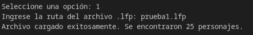
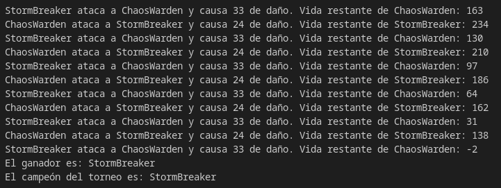
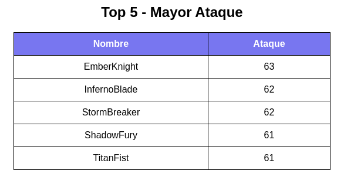
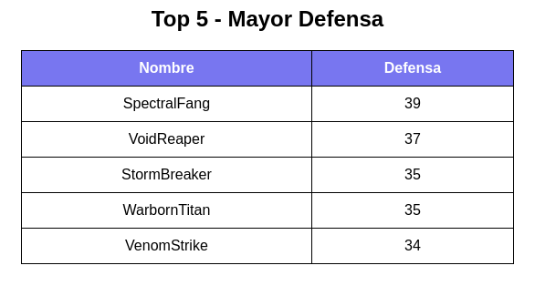

## UNIVERSIDAD DE SAN CARLOS DE GUATEMALA
### FACULTAD DE INGENIERÍA
#### LENGUAJES FORMALES Y DE PROGRAMACIÓN
#### CATEDRÁTICO: Ing. Zulma Karina Aguirre Ordoñez
#### TUTOR ACADÉMICO: Jonatan Leonel García Arana

#### Angel José Cardenas Pocón
#### CARNÉ: 202304063
#### SECCIÓN: B-

#### Guatemala, 2 de marzo del 2025


## Manual de Usuario

## 1. Introducción
Bienvenido a *LFP Battle*, un simulador de torneo de batallas desarrollado en Java. Este sistema permite la carga de un archivo de texto con la información de los personajes, simula enfrentamientos eliminatorios y muestra los resultados en consola. Y, genera un reporte con estadísticas finales del torneo.


## 2. Objetivos del Sistema

### **Objetivo General**
Desarrollar un sistema de simulación de torneos de batalla basado en Programación Orientada a Objetos (POO), permitiendo a los usuarios cargar un archivo de personajes, visualizar los combates en consola y obtener un reporte con las estadísticas finales.

### **Objetivos Específicos**
- Implementar clases y objetos en Java para representar personajes con atributos como nombre, salud, ataque y defensa.
- Manejar archivos de texto  para leer la información de los personajes.
- Aplicar estructuras de control para desarrollar la lógica del combate entre personajes.
- Simular automáticamente los enfrentamientos y mostrar los resultados en consola.
- Generar un reporte en HTML con métricas del torneo, incluyendo los personajes con mayor ataque y defensa.

---

## 3. Información del Sistema

### **3.1. Requisitos Previos**
- Tener instalado **Java (JDK 8 o superior)** en el sistema.
- Disponer de un archivo `.lfp` con la información de los personajes.

### **3.2. Instalación**
1. Descargar el repositorio y abrirlo
2. Compilar el código 
3. Ejecutar el programa 

---

## 4. Flujo del sistema

### **4.1. Carga de Datos**
El usuario debe proporcionar un archivo `.lfp` con el siguiente formato:

```
Nombre|Salud|Ataque|Defensa

```


Cada personaje tiene:
- **Nombre:** Identificador único del personaje.
- **Salud:** Multiplicada por 10 para obtener la vida inicial.
- **Ataque:** Cantidad de daño que inflige.
- **Defensa:** Cantidad de daño que puede reducir.

### **4.2. Desarrollo del Torneo**
- Se generarán enfrentamientos eliminatorios **1 vs 1**.
- Se calculará el daño en cada turno
- El personaje con **0 o menos vida** pierde el combate.
- Si hay un número impar de personajes, uno avanza automáticamente.
- Se mostrarán los resultados en consola.



### **4.3. Reporte Final**
- Al finalizar el torneo, se generará un **reporte en HTML** con:
  - **Top 5 personajes con mayor ataque.**
    

  - **Top 5 personajes con mayor defensa.**

  