## UNIVERSIDAD DE SAN CARLOS DE GUATEMALA
### FACULTAD DE INGENIERÍA
#### LENGUAJES FORMALES Y DE PROGRAMACIÓN
#### CATEDRÁTICO: Ing. Zulma Karina Aguirre Ordoñez
#### TUTOR ACADÉMICO: Jonatan Leonel García Arana

#### Angel José Cardenas Pocón
#### CARNÉ: 202304063
#### SECCIÓN: B-

#### Guatemala, 2 de marzo del 2025

# Manual Técnico - LFP Battle

## 1. Introducción
El Analizador y Generador de Autómatas Finitos Deterministas (AFD) es una aplicación desarrollada en Java con Java Swing que permite la construcción, análisis y visualización de Autómatas Finitos Deterministas. Su propósito principal es servir como una herramienta para el análisis léxico de cadenas de entrada, facilitando la identificación de tokens y errores léxicos.

El sistema está diseñado para procesar archivos en formato .lfp, los cuales contienen la definición del autómata. Una vez cargado el archivo, el programa valida su estructura y genera un modelo gráfico del autómata si no se detectan errores. En caso contrario, despliega una tabla con los errores encontrados.

---

## 2. Objetivos del Sistema

### **Objetivo General**
Diseñar e implementar una aplicación que permita la creación, análisis y representación gráfica de Autómatas Finitos Deterministas (AFD), integrando funcionalidades para el procesamiento de archivos .lfp, el análisis léxico de cadenas de entrada y la generación de reportes de tokens y errores léxicos.
### **Objetivos Específicos**
1. Desarrollar un analizador léxico manual que lea archivos .lfp y convierta su contenido en una estructura de datos basada en Programación Orientada a Objetos (POO), sin utilizar herramientas externas como ANTLR, JFlex o Lex.

2. Implementar un módulo gráfico en Java Swing que permita la visualización del autómata generado y proporcione una interfaz para la carga de archivos y la ejecución del análisis léxico.

3. Diseñar un sistema de reporte de tokens y errores que genere información estructurada sobre la validez de las cadenas de entrada, permitiendo su exportación para su posterior análisis.

---

## 3. Requisitos del Sistema

### **3.1. Requisitos de Software**
- **Sistema Operativo:** Windows, macOS o Linux.
- **Java Development Kit (JDK):** Versión 8 o superior.
- **Editor de Código o IDE recomendado:** IntelliJ IDEA, Eclipse o Visual Studio Code.
- **Herramienta de compilación:** Javac (incluido en el JDK).
- **Navegador Web:** Para visualizar el reporte HTML generado.

### **3.2. Requisitos de Hardware**
- **Procesador:** Mínimo Intel Core i3 / AMD Ryzen 3 o superior.
- **Memoria RAM:** 4 GB mínimo (8 GB recomendado para un mejor rendimiento).
- **Almacenamiento:** 100 MB de espacio disponible para archivos y logs.
- **Pantalla:** Resolución mínima de 1280x720.

## 4. Lògica del programa
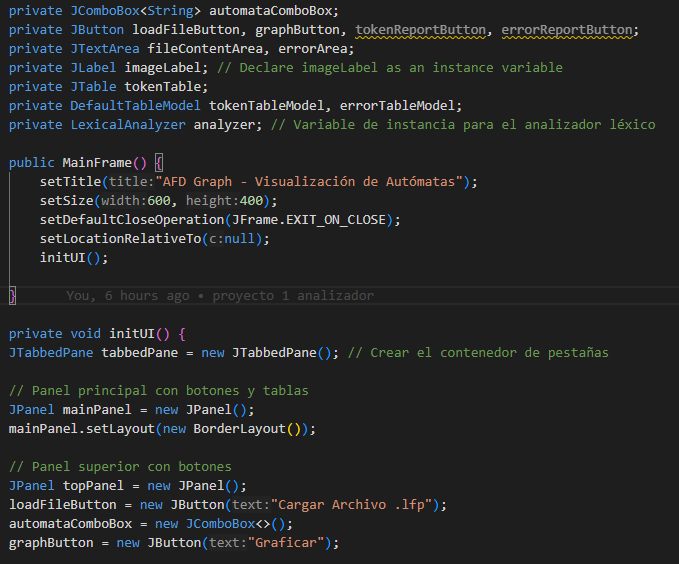
# **Explicación del Código - MainFrame (Interfaz Gráfica)**

## **Declaración de Variables**  
La clase `MainFrame` contiene varios componentes de la interfaz gráfica que permiten la interacción del usuario con el programa.  

- **`automataComboBox`**:  
  Un menú desplegable (`JComboBox<String>`) que permite seleccionar distintos autómatas cargados en el programa.  

- **Botones (`JButton`)**:  
  - `loadFileButton`: Permite al usuario cargar un archivo **.lfp** con la definición del autómata.  
  - `graphButton`: Inicia el proceso de análisis y genera la representación gráfica del autómata.  
  - `tokenReportButton`: Genera un informe detallado de los tokens reconocidos en el análisis léxico.  
  - `errorReportButton`: Muestra un reporte de los errores léxicos encontrados en el archivo cargado.  

- **Áreas de Texto (`JTextArea`)**:  
  - `fileContentArea`: Muestra el contenido del archivo **.lfp** para que el usuario pueda visualizarlo.  
  - `errorArea`: Presenta los errores detectados durante el análisis léxico.  

- **Etiqueta para la Imagen (`JLabel`)**:  
  - `imageLabel`: Se usa para mostrar la imagen del autómata generado tras el análisis exitoso.  

- **Tablas (`JTable`)**:  
  - `tokenTable`: Muestra los tokens analizados en formato tabular.  
  - `tokenTableModel` y `errorTableModel`: Son los modelos de datos utilizados para gestionar el contenido de las tablas de tokens y errores.  

- **Analizador Léxico (`LexicalAnalyzer`)**:  
  - `analyzer`: Instancia del analizador léxico que procesa el archivo **.lfp**, generando tokens y detectando errores.  

---

## **Constructor de la Clase**  
El constructor `MainFrame()` se encarga de configurar la ventana principal de la aplicación con los siguientes ajustes:  

- **Título de la ventana**: Se establece el nombre `"AFD Graph - Visualización de Autómatas"`.  
- **Tamaño de la ventana**: Se define con dimensiones **600x400 píxeles**.  
- **Cierre del programa**: Se configura para que la aplicación termine al cerrar la ventana.  
- **Posicionamiento en pantalla**: Se centra automáticamente en la pantalla del usuario.  
- **Inicialización de la interfaz (`initUI()`)**: Se invoca un método encargado de agregar y organizar los componentes gráficos.  

---

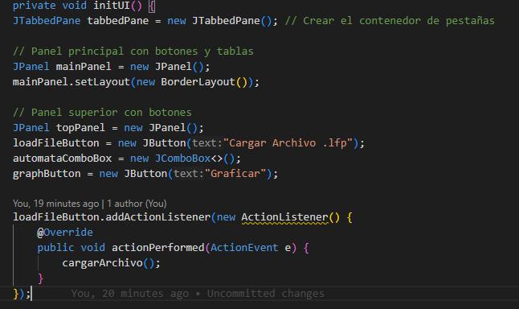
# **Explicación del Método `initUI()`**

El método `initUI()` es responsable de configurar y organizar los elementos de la interfaz gráfica de la aplicación. Se estructura en varias secciones para distribuir correctamente los componentes en la ventana principal.

---

## **1. Creación del Contenedor de Pestañas (`JTabbedPane`)**  
- Se instancia un `JTabbedPane`, que permitirá organizar diferentes secciones de la interfaz dentro de pestañas.  
- Este componente facilita la navegación entre diferentes funcionalidades, como la visualización del autómata, el análisis léxico y los reportes.

---

## **2. Creación del Panel Principal (`JPanel`)**  
- Se crea un `JPanel` llamado `mainPanel`, el cual actúa como el **contenedor principal** de la interfaz.  
- Se establece su diseño con un `BorderLayout`, permitiendo distribuir los componentes en distintas áreas (norte, centro, sur, etc.).

---

## **3. Creación del Panel Superior (`JPanel`)**  
- Se define un `JPanel` adicional (`topPanel`), que contendrá los **botones de control**.  
- Este panel no tiene un diseño predefinido, por lo que los componentes se agregarán en orden secuencial.

---

## **4. Inicialización de los Componentes de la Interfaz**  
Se crean e instancian los elementos que permitirán la interacción del usuario:

- **`loadFileButton`**:  
  - Botón con la etiqueta `"Cargar Archivo .lfp"`.  
  - Permite al usuario seleccionar un archivo con la definición del autómata.

- **`automataComboBox`**:  
  - Menú desplegable (`JComboBox<String>`) donde se cargarán los nombres de los autómatas disponibles en el sistema.  
  - Inicialmente está vacío y se llenará dinámicamente tras cargar un archivo.

- **`graphButton`**:  
  - Botón con la etiqueta `"Graficar"`.  
  - Al presionarlo, se iniciará el proceso de análisis y representación gráfica del autómata.

---

## **5. Manejo del Evento de Carga de Archivo**  
- Se agrega un `ActionListener` al botón `loadFileButton`.  
- Cuando el usuario presiona este botón, se ejecuta el método `cargarArchivo()`, que gestionará la apertura y lectura del archivo **.lfp**.  
- Se utiliza una clase anónima (`new ActionListener() {}`) para definir la acción dentro del `addActionListener()`.

---

Este método establece la estructura básica de la interfaz y permite la interacción inicial del usuario con la aplicación.

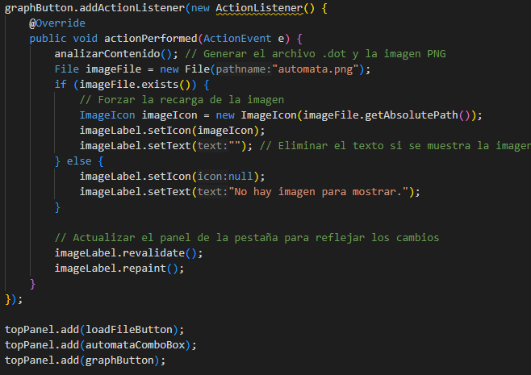
# **Manejo del Evento para el Botón `graphButton`**

Este fragmento de código se encarga de gestionar el evento cuando el usuario presiona el botón **"Graficar"** (`graphButton`). Su función principal es analizar el contenido del archivo cargado y generar la imagen correspondiente al autómata.

---

## **1. Acción Asociada al Botón**  
- Se añade un `ActionListener` al botón **`graphButton`**.  
- Cuando el usuario hace clic, se ejecuta el método **`analizarContenido()`**, que es responsable de:  
  - Procesar el contenido del archivo cargado.  
  - Generar el archivo **.dot** necesario para la visualización del autómata.  
  - Convertir el archivo **.dot** en una imagen **PNG** que representará el autómata gráficamente.

---

## **2. Verificación de la Imagen Generada**  
Después de llamar al método `analizarContenido()`, el programa intenta cargar y mostrar la imagen generada (`automata.png`):

- Se crea un objeto `File` (`imageFile`) apuntando al archivo `"automata.png"`.  
- Se verifica si el archivo existe:
  - **Si la imagen está disponible**:  
    - Se carga la imagen utilizando `ImageIcon`.  
    - Se actualiza la etiqueta (`imageLabel`) para mostrar la imagen en la interfaz.  
    - Se borra cualquier texto previo en la etiqueta.  
  - **Si la imagen no existe**:  
    - Se elimina cualquier icono previo en `imageLabel`.  
    - Se muestra un mensaje `"No hay imagen para mostrar."` en su lugar.  

---

## **3. Actualización de la Interfaz**  
- **`imageLabel.revalidate();`**  
  - Informa al contenedor que la disposición de los componentes ha cambiado y que debe actualizarse.  
- **`imageLabel.repaint();`**  
  - Redibuja la etiqueta para reflejar los cambios visuales inmediatamente.

---

## **4. Adición de Componentes al Panel Superior**  
Finalmente, los botones y el menú desplegable se agregan al `topPanel`, permitiendo que sean visibles y accesibles en la interfaz:

- `topPanel.add(loadFileButton);` → Botón para cargar archivos.  
- `topPanel.add(automataComboBox);` → Menú desplegable con los autómatas cargados.  
- `topPanel.add(graphButton);` → Botón para graficar el autómata.  

---
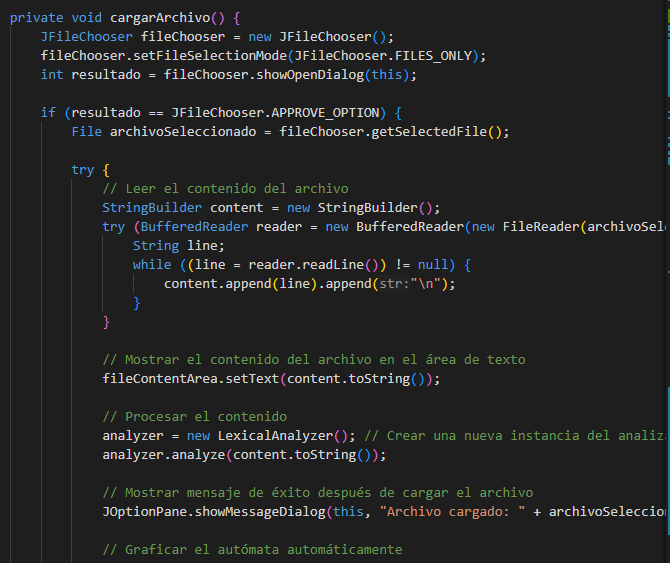
# **Método `cargarArchivo()`**

El método `cargarArchivo()` se encarga de permitir al usuario seleccionar un archivo **.lfp** y cargar su contenido en la aplicación. Este proceso incluye la lectura del archivo, el análisis léxico y la visualización del contenido en la interfaz gráfica.

---

## **1. Selección de Archivo (`JFileChooser`)**
- **`JFileChooser`**: Se utiliza para mostrar un cuadro de diálogo que permite al usuario seleccionar un archivo.  
  - `fileChooser.setFileSelectionMode(JFileChooser.FILES_ONLY);`  
    - Limita la selección a archivos, no a directorios.  
  - **`fileChooser.showOpenDialog(this)`**: Muestra el cuadro de diálogo para abrir un archivo. Si el usuario selecciona un archivo, el valor devuelto será **`JFileChooser.APPROVE_OPTION`**.

---

## **2. Lectura del Contenido del Archivo**
Si el usuario selecciona un archivo, se lee su contenido:

- **`BufferedReader reader = new BufferedReader(new FileReader(archivoSeleccionado));`**  
  - Se utiliza para leer el archivo línea por línea.  
- **`StringBuilder content = new StringBuilder();`**  
  - Se usa un `StringBuilder` para almacenar el contenido del archivo de manera eficiente.  
- El archivo se lee línea por línea con el bucle **`while ((line = reader.readLine()) != null)`** y cada línea se agrega al `StringBuilder`.

---

## **3. Visualización del Contenido en la Interfaz**
- **`fileContentArea.setText(content.toString());`**  
  - El contenido leído del archivo se muestra en el área de texto `fileContentArea`, permitiendo al usuario ver el archivo cargado en la interfaz.

---

## **4. Análisis Léxico**
- **`analyzer = new LexicalAnalyzer();`**  
  - Se crea una nueva instancia del analizador léxico.  
- **`analyzer.analyze(content.toString());`**  
  - Se pasa el contenido del archivo al analizador para que realice el análisis léxico.

---

## **5. Mensaje de Éxito**
- **`JOptionPane.showMessageDialog()`**:  
  - Se muestra un cuadro de mensaje confirmando que el archivo ha sido cargado exitosamente.  
  - El mensaje incluye el nombre del archivo que se ha cargado.

---

## **6. Generación Automática del Autómata**
- **`generarGraphviz();`**  
  - Este método se llama para generar automáticamente el autómata en formato gráfico después de que el archivo haya sido cargado y procesado.

---

## **7. Manejo de Errores**
- En caso de que ocurra un error al leer el archivo, se captura una excepción y se muestra un mensaje de error al usuario utilizando **`JOptionPane.showMessageDialog()`**.

---
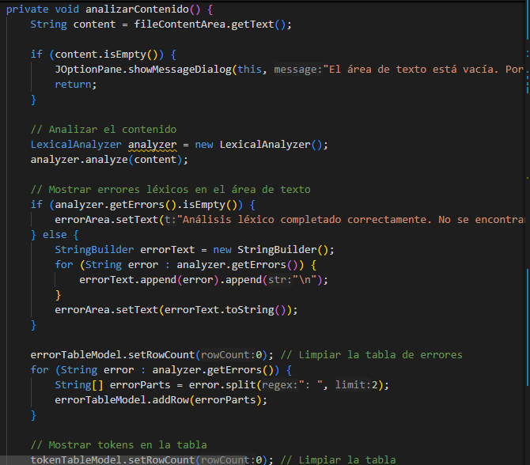
# **Método `analizarContenido()`**

El método `analizarContenido()` se encarga de realizar el análisis léxico del contenido cargado en el área de texto y mostrar los resultados, ya sea errores léxicos o tokens reconocidos. Además, genera automáticamente la representación gráfica del autómata.

---

## **1. Obtención del Contenido del Archivo**
- **`String content = fileContentArea.getText();`**  
  - Se obtiene el contenido del área de texto `fileContentArea`, que contiene el archivo **.lfp** que el usuario ha cargado.

---

## **2. Verificación del Contenido Vacío**
- **`if (content.isEmpty())`**  
  - Se verifica si el área de texto está vacía.  
  - Si está vacía, se muestra un mensaje de advertencia al usuario solicitando que ingrese contenido para analizar. El proceso termina con `return` si no hay contenido.

---

## **3. Análisis Léxico del Contenido**
- **`LexicalAnalyzer analyzer = new LexicalAnalyzer();`**  
  - Se crea una nueva instancia de `LexicalAnalyzer`, que es la clase encargada de analizar el contenido.  
- **`analyzer.analyze(content);`**  
  - Se pasa el contenido del archivo al analizador léxico para identificar tokens y errores.

---

## **4. Manejo de Errores Léxicos**
- **`if (analyzer.getErrors().isEmpty())`**  
  - Si no se encuentran errores léxicos, se muestra un mensaje indicando que el análisis fue exitoso y sin errores.  
- **`else`**  
  - Si hay errores, se construye un mensaje con todos los errores encontrados utilizando un `StringBuilder` y se muestra en el área de texto `errorArea`.

---

## **5. Actualización de la Tabla de Errores**
- **`errorTableModel.setRowCount(0);`**  
  - Se limpia la tabla de errores antes de agregar los nuevos errores.  
- Se recorre la lista de errores léxicos y cada error se divide en dos partes utilizando `split(": ", 2)` para separar la descripción del error.  
- **`errorTableModel.addRow(errorParts);`**  
  - Se agrega cada error a la tabla de errores.

---

## **6. Actualización de la Tabla de Tokens**
- **`tokenTableModel.setRowCount(0);`**  
  - Se limpia la tabla de tokens antes de agregar los nuevos tokens.  
- Similar a los errores, se recorre la lista de tokens y se separa cada token en dos partes.  
- **`tokenTableModel.addRow(tokenParts);`**  
  - Se agrega cada token a la tabla de tokens.

---

## **7. Generación Automática del Autómata**
- **`generarGraphviz();`**  
  - Después de realizar el análisis, se genera el autómata automáticamente en formato gráfico.

---
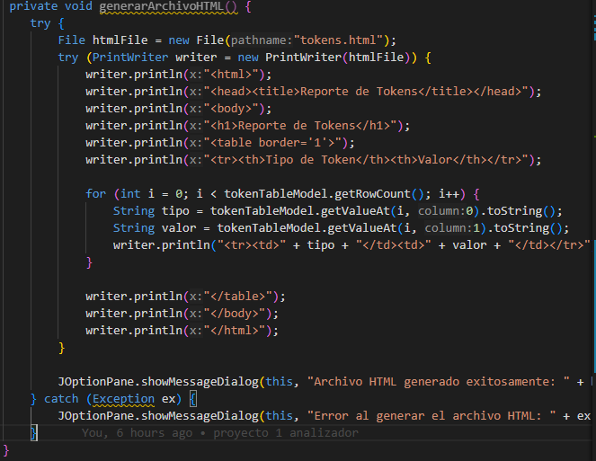
# **Método `generarArchivoHTML()`**

El método `generarArchivoHTML()` es responsable de crear un archivo **HTML** que contiene un reporte con los tokens identificados en el análisis léxico. Este archivo se guarda en la ubicación especificada y se notifica al usuario si la operación fue exitosa o si hubo algún error.

---

## **1. Creación del Archivo HTML**
- **`File htmlFile = new File("tokens.html");`**  
  - Se crea un archivo **HTML** llamado `tokens.html` donde se almacenará el reporte de los tokens.

---

## **2. Escritura en el Archivo HTML**
- **`try (PrintWriter writer = new PrintWriter(htmlFile))`**  
  - Se utiliza un `PrintWriter` para escribir contenido en el archivo **HTML**. El `PrintWriter` se asegura de que el archivo sea cerrado automáticamente al final del bloque `try` gracias a la declaración `try-with-resources`.

---

## **3. Estructura del Archivo HTML**
Dentro del bloque `PrintWriter`, se escribe la estructura básica del archivo HTML:

- **`<html>` y `<head>`**: Se define el inicio del documento HTML y su cabecera, donde se establece el título del reporte.
- **`<body>`**: Se comienza la sección del cuerpo del archivo, donde se incluirá el contenido principal.
  - **`<h1>`**: Título principal que indica que se trata de un "Reporte de Tokens".
  - **`<table>`**: Se crea una tabla con bordes (`border='1'`) que contendrá los tokens.  
    - Las columnas de la tabla son **"Tipo de Token"** y **"Valor"**.
  
---

## **4. Iteración y Escritura de los Tokens**
- **`for (int i = 0; i < tokenTableModel.getRowCount(); i++)`**  
  - Se itera sobre las filas de la tabla `tokenTableModel`, que contiene los tokens.
  - Para cada fila (representando un token), se obtienen el tipo y el valor del token mediante **`tokenTableModel.getValueAt(i, 0)`** para el tipo y **`tokenTableModel.getValueAt(i, 1)`** para el valor.
  - Estos datos se insertan en una fila de la tabla HTML:
    - **`<tr><td>" + tipo + "</td><td>" + valor + "</td></tr>`**

---

## **5. Cierre del Archivo HTML**
- Después de escribir todos los tokens, se cierran las etiquetas HTML:  
  - **`</table>`**: Cierra la tabla.  
  - **`</body>` y `</html>`**: Finalizan el cuerpo y el documento HTML.

---

## **6. Notificación de Éxito**
- **`JOptionPane.showMessageDialog(this, "Archivo HTML generado exitosamente: " + htmlFile.getAbsolutePath(), "Éxito", JOptionPane.INFORMATION_MESSAGE);`**  
  - Si la generación del archivo HTML fue exitosa, se muestra un cuadro de mensaje informando al usuario sobre la ubicación del archivo generado.

---

## **7. Manejo de Errores**
- Si ocurre un error durante el proceso, se captura una excepción y se muestra un mensaje de error con detalles sobre el problema:
  - **`JOptionPane.showMessageDialog(this, "Error al generar el archivo HTML: " + ex.getMessage(), "Error", JOptionPane.ERROR_MESSAGE);`**

---
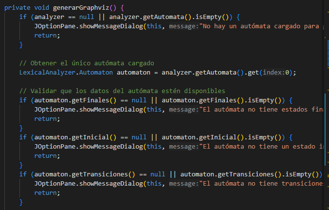
# **Método `generarGraphviz()`**

El método `generarGraphviz()` es responsable de generar una representación gráfica de un autómata en formato **.png** utilizando **Graphviz**. Este proceso incluye la creación de un archivo **.dot** que describe el autómata y la ejecución de Graphviz para generar la imagen correspondiente.

---

## **1. Verificación de la Existencia de un Autómata**
- **`if (analyzer == null || analyzer.getAutomata().isEmpty())`**  
  - Se verifica si el **analizador léxico** (`analyzer`) está disponible y si tiene un autómata cargado.
  - Si no hay un autómata cargado, se muestra un mensaje de error indicando que no hay un autómata para graficar y se detiene el proceso.

---

## **2. Obtener el Autómata**
- **`LexicalAnalyzer.Automaton automaton = analyzer.getAutomata().get(0);`**  
  - Se obtiene el primer (y único) autómata cargado desde el analizador léxico.

---

## **3. Validaciones del Autómata**
Antes de proceder con la creación del gráfico, se realizan varias validaciones sobre el autómata:

- **Validación de Estados Finales**:  
  - Se verifica que el autómata tenga **estados finales** definidos. Si no es así, se muestra un mensaje de error y se detiene el proceso.

- **Validación del Estado Inicial**:  
  - Se verifica que el autómata tenga un **estado inicial** definido. Si no es así, se muestra un mensaje de error y se detiene el proceso.

- **Validación de Transiciones**:  
  - Se verifica que el autómata tenga **transiciones** definidas. Si no es así, se muestra un mensaje de error y se detiene el proceso.

---

## **4. Generación del Archivo `.dot`**
Si las validaciones son exitosas, se genera un archivo **.dot** que describe el autómata en el formato necesario para Graphviz:

- **`File dotFile = new File("automata.dot");`**  
  - Se crea un archivo **automata.dot** donde se guardará la descripción del autómata.

- **`PrintWriter writer = new PrintWriter(dotFile)`**  
  - Se utiliza un `PrintWriter` para escribir en el archivo **.dot**.

- **Estructura del archivo `.dot`**:  
  - Se define un gráfico dirigido con **`digraph Automaton {`**.
  - La dirección de los nodos se establece de izquierda a derecha con **`rankdir=LR;`**.
  - Se especifica que los nodos (estados) tienen forma circular con **`node [shape=circle];`**.

- **Escritura de los Estados Finales**:  
  - Se marca cada estado final con el atributo **`shape=doublecircle`**.

- **Escritura del Estado Inicial**:  
  - Se agrega un nodo de inicio **`inicio`** con forma de punto y una transición desde este nodo hacia el estado inicial.

- **Escritura de las Transiciones**:  
  - Se recorren las transiciones del autómata y se escriben en el formato adecuado en el archivo **.dot**:
    - Cada transición se define como **`origen -> destino [label="simbolo"];`**.
    - Se valida que cada transición tenga 3 elementos (origen, símbolo y destino).

---

## **5. Ejecución de Graphviz**
Una vez que el archivo **.dot** está listo, se ejecuta **Graphviz** para generar la imagen del autómata:

- **`Process process = Runtime.getRuntime().exec("dot -Tpng automata.dot -o automata.png");`**  
  - Se ejecuta el comando **Graphviz** para convertir el archivo **.dot** en una imagen **PNG**.

- **`process.waitFor();`**  
  - Se espera que el proceso termine antes de continuar.

---

## **6. Verificación de la Generación de la Imagen**
- **`File imageFile = new File("automata.png");`**  
  - Se verifica si el archivo **automata.png** ha sido generado correctamente.

- **Mensaje de Éxito**:  
  - Si la imagen ha sido generada correctamente, se muestra un mensaje informando al usuario sobre la ubicación del archivo de la imagen.

- **Mensaje de Error**:  
  - Si no se pudo generar la imagen, se muestra un mensaje de error indicando el problema.

---

## **7. Manejo de Errores**
- Durante todo el proceso, si ocurre algún error (al generar el archivo **.dot** o al ejecutar **Graphviz**), se captura una excepción y se muestra un mensaje de error detallado al usuario.

---
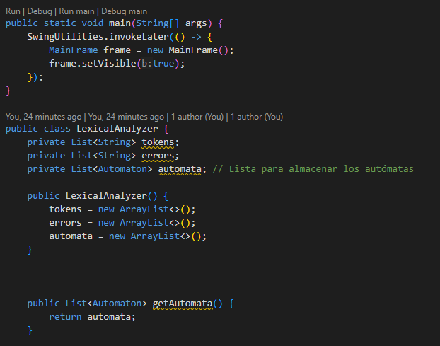
# **Método `main()` y Clase `LexicalAnalyzer`**

## **1. Método `main()`**

El método `main()` es el punto de entrada principal para ejecutar la aplicación gráfica utilizando **Swing**.

### **Flujo del Método `main()`**
- **`SwingUtilities.invokeLater(() -> { ... });`**  
  - Este bloque asegura que la creación y visualización de la interfaz de usuario se realice en el hilo de despacho de eventos de **Swing**, que es el hilo principal de la interfaz gráfica.
  - La razón de usar `invokeLater()` es que **Swing** no es seguro para subprocesos, es decir, no debe manipularse desde hilos distintos al hilo de eventos.

- **`MainFrame frame = new MainFrame();`**  
  - Se crea una nueva instancia de la clase `MainFrame`, que es la ventana principal de la aplicación.
  - `MainFrame` es responsable de la interfaz gráfica, incluyendo los botones, tablas, y áreas de texto.

- **`frame.setVisible(true);`**  
  - Hace que la ventana de la aplicación se haga visible al usuario.
  - Al ejecutarse este código, la ventana de la interfaz gráfica se abrirá, permitiendo la interacción con la aplicación.

Este método es necesario para iniciar la aplicación y cargar la interfaz gráfica de usuario (GUI).

---

## **2. Clase `LexicalAnalyzer`**

La clase `LexicalAnalyzer` es responsable de analizar léxicamente el contenido de los archivos cargados, identificando tokens y errores en el texto. También gestiona una lista de autómatas generados durante el proceso.

### **Atributos de la Clase `LexicalAnalyzer`**
- **`private List<String> tokens;`**  
  - Lista que almacena los **tokens** (por ejemplo, palabras clave, identificadores, operadores) identificados en el texto durante el análisis léxico.

- **`private List<String> errors;`**  
  - Lista que almacena los **errores léxicos** encontrados durante el proceso de análisis.
  - Estos errores pueden incluir tokens no reconocidos o mal formateados.

- **`private List<Automaton> automata;`**  
  - Lista que almacena los **autómatas** generados.
  - Un **autómata** se utiliza para visualizar las estructuras de estado y transiciones relacionadas con el análisis léxico.

### **Métodos de la Clase `LexicalAnalyzer`**

#### **Constructor `LexicalAnalyzer()`**
- **`public LexicalAnalyzer() { ... }`**
  - Inicializa las listas de **tokens**, **errores** y **autómatas**.
  - Estas listas se inicializan como nuevas instancias de **`ArrayList`**, permitiendo almacenar los elementos que se generarán durante el análisis léxico.

#### **Método `getAutomata()`**
- **`public List<Automaton> getAutomata() { ... }`**
  - Este método devuelve la lista de **autómatas** generados durante el proceso de análisis.
  - El autómata es un componente central en el análisis de lenguajes formales y se utiliza para representar el comportamiento léxico de un lenguaje.

---
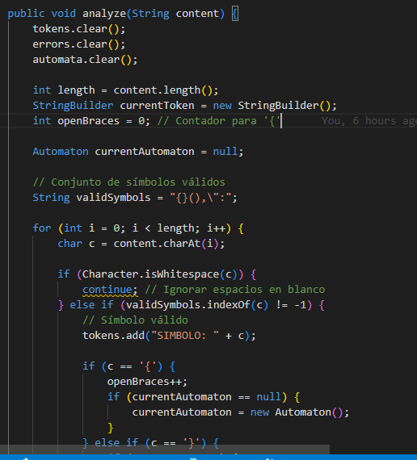
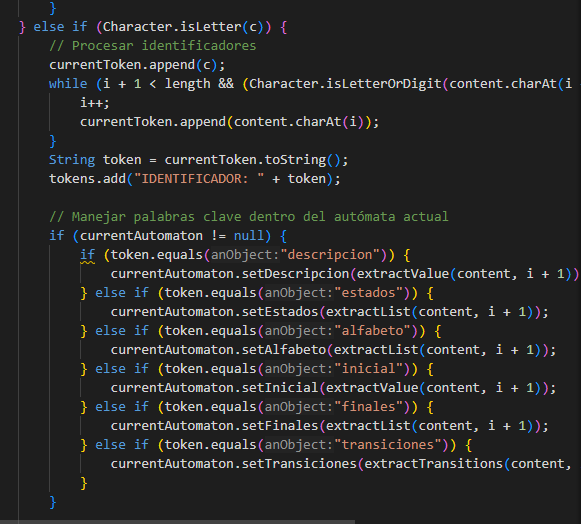
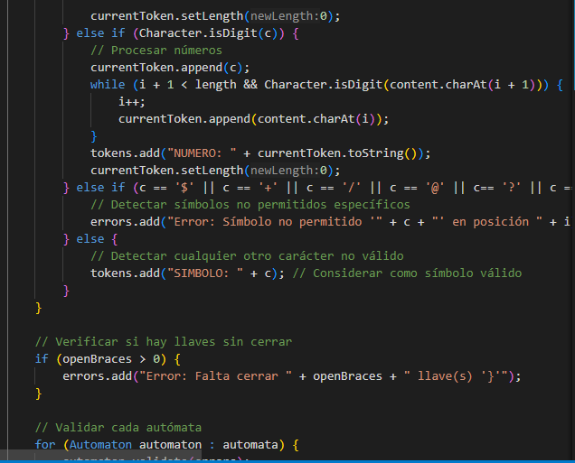
# **Método `analyze(String content)`**

Este método es parte de la clase `LexicalAnalyzer` y se encarga de realizar el **análisis léxico** del contenido de un archivo de texto, buscando identificar tokens válidos, manejar errores y generar autómatas basados en las palabras clave encontradas.

## **Flujo del Método `analyze()`**

### **Inicialización de Variables**
- **`tokens.clear();`**  
  Se limpian las listas de tokens anteriores antes de realizar un nuevo análisis.
  
- **`errors.clear();`**  
  Se limpia la lista de errores previos.

- **`automata.clear();`**  
  Se limpia la lista de autómatas generados durante el análisis.

- **`int length = content.length();`**  
  Se obtiene la longitud del contenido que se va a analizar.

- **`StringBuilder currentToken = new StringBuilder();`**  
  Se crea un objeto `StringBuilder` para ir construyendo los tokens.

- **`int openBraces = 0;`**  
  Se inicializa un contador para las llaves `{`, que será utilizado para validar que cada llave de apertura tenga una de cierre correspondiente.

- **`Automaton currentAutomaton = null;`**  
  Se inicializa la variable `currentAutomaton` para almacenar el autómata que se está generando.

### **Conjunto de Símbolos Válidos**
- **`String validSymbols = "{}(),\":";`**  
  Se define un conjunto de caracteres que son símbolos válidos dentro del contenido. Estos símbolos se manejan específicamente durante el análisis.

### **Recorrido de cada Caracter en el Contenido**
El bucle principal del método recorre cada carácter del contenido de entrada.

#### **1. Manejo de Espacios en Blanco**
- **`if (Character.isWhitespace(c)) { continue; }`**  
  Si el carácter es un espacio en blanco, el ciclo continúa sin hacer nada.

#### **2. Manejo de Símbolos Válidos**
- **`if (validSymbols.indexOf(c) != -1)`**  
  Si el carácter es uno de los símbolos válidos definidos previamente, se agrega a la lista de tokens.
  
  Además, si el símbolo es una llave de apertura `{`, se aumenta el contador `openBraces` y se inicia un nuevo autómata si no existe uno. Si el símbolo es una llave de cierre `}`, se valida que haya una llave de apertura correspondiente.

#### **3. Manejo de Identificadores**
- **`else if (Character.isLetter(c)) { ... }`**  
  Si el carácter es una letra, se procesa como un identificador. 
  - Se utiliza un `StringBuilder` para construir el identificador completo, que puede estar compuesto por letras, números o el carácter `_`.
  - Una vez completado el identificador, se agrega a la lista de tokens.
  - Además, se manejan palabras clave específicas (como `descripcion`, `estados`, `alfabeto`, etc.) y se extraen valores o listas asociadas a ellas para configurarlas en el autómata actual.

#### **4. Manejo de Números**
- **`else if (Character.isDigit(c)) { ... }`**  
  Si el carácter es un número, se construye el número completo y se agrega a la lista de tokens.

#### **5. Manejo de Símbolos No Permitidos**
- **`else if (c == '$' || c == '+' || c == '/' || ... )`**  
  Se detectan símbolos no permitidos y se agrega un error a la lista de errores si se encuentra uno de estos caracteres.

#### **6. Otros Caracteres**
- **`else { tokens.add("SIMBOLO: " + c); }`**  
  Cualquier otro carácter que no sea manejado específicamente en las condiciones anteriores se considera un "símbolo válido" y se agrega como tal a la lista de tokens.

### **Validación Final**
- **`if (openBraces > 0) { errors.add("Error: Falta cerrar ..."); }`**  
  Si al final del análisis aún quedan llaves `{` no cerradas, se agrega un error indicando cuántas llaves de cierre faltan.

### **Validación de los Autómatas**
- **`for (Automaton automaton : automata) { automaton.validate(errors); }`**  
  Cada autómata generado durante el análisis es validado mediante su propio método `validate()`. Si se detectan problemas o inconsistencias dentro de un autómata, se agregan errores a la lista.

---
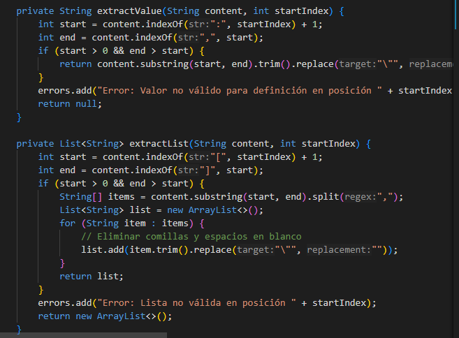
## Explicación Detallada del Método `extractValue`

Este método tiene como objetivo extraer un valor de una cadena de texto (`content`) que se encuentra entre un par de caracteres específicos: un `:` y una coma `,`. Aquí se detallan todos los pasos involucrados en el proceso.

### Paso 1: Encontrar el inicio del valor a extraer (`start`)

- **Método `indexOf(":", startIndex)`**: Utilizamos este método para encontrar la primera ocurrencia del carácter `:` en la cadena `content`, pero comenzamos a buscar a partir de la posición dada por `startIndex`. El propósito de esta búsqueda es localizar el símbolo `:` que precede al valor que necesitamos extraer. En un contexto de archivo o de estructura de datos, un `:` suele utilizarse para separar una clave de su valor correspondiente.
  
- **¿Por qué `startIndex`?**: La variable `startIndex` es crucial para definir desde qué punto de la cadena queremos comenzar la búsqueda. Esto es útil en contextos donde ya hemos procesado parte del contenido y necesitamos encontrar la próxima aparición del símbolo `:` sin examinar todo el texto nuevamente.
  
- **Sumar `+1` a la posición de `:`**: Después de encontrar el `:`, sumamos `1` a la posición obtenida, ya que el `:` en sí mismo no es parte del valor que deseamos extraer. Lo que nos interesa es el valor que sigue al `:`. De este modo, movemos el índice un paso adelante para comenzar la extracción desde el primer carácter después del `:`.

### Paso 2: Encontrar el final del valor a extraer (`end`)

- **Método `indexOf(",", start)`**: Una vez que hemos localizado el inicio del valor (justo después del `:`), usamos este método para encontrar la primera coma `,` en la cadena `content`, comenzando desde la posición `start`. La coma se utiliza aquí como delimitador para marcar el final del valor. En estructuras de datos como JSON o en lenguajes de configuración, las comas a menudo se usan para separar valores, por lo que este método nos permite identificar el final del valor que queremos extraer.
  
- **¿Por qué usar la coma como delimitador?**: La coma es un delimitador común en muchos formatos de texto o estructuras de datos (como JSON, CSV, etc.), por lo que nos resulta útil para identificar la frontera del valor que estamos extrayendo. Al encontrar la primera coma después del valor, sabemos que todo lo que está entre el `:` y la coma es el valor que estamos buscando.

### Paso 3: Validar y Extraer el Valor

- **Condiciones de validez**: Para asegurarnos de que la extracción se haga correctamente, verificamos si las posiciones `start` y `end` son válidas. Esto significa que `start` debe ser mayor que 0 (es decir, hemos encontrado un `:`) y `end` debe ser mayor que `start` (es decir, hemos encontrado una coma después del valor). Si alguna de estas condiciones no se cumple, significa que la extracción no se puede realizar correctamente, y se genera un error.

- **Extracción del valor**: Si las posiciones `start` y `end` son válidas, utilizamos `content.substring(start, end)` para extraer el valor desde el índice `start` hasta el índice `end`. Esto nos da una subcadena que contiene el valor entre el `:` y la coma. Luego, aplicamos dos operaciones adicionales:
  
  - **`trim()`**: El método `trim()` elimina cualquier espacio en blanco extra al principio y al final del valor, asegurando que el valor extraído no tenga espacios innecesarios.
  - **`replace("\"", "")`**: Si el valor extraído contiene comillas dobles (`"`), las eliminamos para obtener el valor limpio. Esto es común cuando los valores en cadenas de texto están entre comillas (por ejemplo, en formatos como JSON o CSV).

### Paso 4: Manejo de Errores

- **Generación de errores**: Si las condiciones de validez no se cumplen o si no podemos extraer el valor correctamente, se agrega un mensaje de error a la lista `errors`. El mensaje incluye la posición en la que ocurrió el problema, lo que facilita la depuración y la identificación de posibles errores en el formato de entrada.

- **Devolver `null`**: Si se produjo un error durante el proceso de extracción, el método devuelve `null`, lo que indica que no se pudo extraer un valor válido.

---
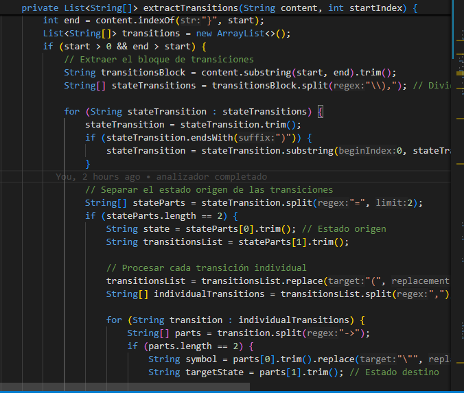
## Explicación Detallada del Método `extractTransitions`

El método `extractTransitions` tiene como objetivo extraer las transiciones de un autómata a partir de una cadena de texto (`content`) que sigue un formato específico. Estas transiciones están contenidas dentro de un bloque delimitado por `{` y `}`, y cada transición está definida por un conjunto de estados y símbolos. El proceso se detalla a continuación.

### Paso 1: Encontrar el inicio y fin del bloque de transiciones

- **`int start = content.indexOf("{", startIndex) + 1;`**: Utilizamos el método `indexOf` para encontrar la posición del primer carácter `{` en la cadena `content`, comenzando la búsqueda desde `startIndex`. Sumamos 1 al índice para movernos un paso después de `{`, ya que el bloque de transiciones empieza justo después de este símbolo.
  
- **`int end = content.indexOf("}", start);`**: Luego, buscamos el carácter `}` que indica el final del bloque de transiciones, comenzando desde el índice `start` encontrado previamente. Esto nos permite delimitar el bloque de transiciones.

### Paso 2: Validar el rango del bloque de transiciones

- **Condiciones de validez**: Antes de proceder, verificamos que tanto `start` como `end` sean valores válidos:
  - `start > 0`: Asegura que hemos encontrado un `{` válido.
  - `end > start`: Asegura que el `}` está después del `{`, lo que garantiza que el bloque tiene contenido.

Si cualquiera de estas condiciones no se cumple, se genera un error indicando que el bloque de transiciones no es válido en la posición especificada.

### Paso 3: Extraer y dividir el bloque de transiciones

- **`String transitionsBlock = content.substring(start, end).trim();`**: Extraemos el bloque de transiciones desde el índice `start` hasta `end`, y utilizamos `trim()` para eliminar cualquier espacio en blanco adicional al principio y al final del bloque.
  
- **`String[] stateTransitions = transitionsBlock.split("\\),");`**: Dividimos el bloque de transiciones en partes individuales utilizando la expresión regular `\\),` para dividir por la secuencia `),`, que es la forma en que las transiciones están separadas en el formato de entrada.

### Paso 4: Procesar cada transición individual

Para cada transición, realizamos los siguientes pasos:

1. **`stateTransition = stateTransition.trim();`**: Elimino cualquier espacio en blanco adicional alrededor de cada transición.

2. **`if (stateTransition.endsWith(")")) {`**: Verificamos si la transición termina con un paréntesis `)`, lo cual indica que debemos eliminarlo.

3. **`stateTransition = stateTransition.substring(0, stateTransition.length() - 1);`**: Si la transición termina con `)`, lo eliminamos.

### Paso 5: Separar el estado de las transiciones

- **`String[] stateParts = stateTransition.split("=", 2);`**: Dividimos la transición en dos partes utilizando el `=` como delimitador. El primer elemento será el estado de origen y el segundo será la lista de transiciones para ese estado.

- **`if (stateParts.length == 2)`**: Si el número de partes es 2, significa que hemos encontrado una transición válida con un estado de origen y una lista de transiciones. Si no, se genera un error indicando que la transición no es válida.

### Paso 6: Procesar cada transición individual

1. **`String state = stateParts[0].trim();`**: Extraemos y limpiamos el estado de origen.

2. **`String transitionsList = stateParts[1].trim();`**: Extraemos la lista de transiciones y la limpiamos.

3. **`transitionsList = transitionsList.replace("(", "").replace(")", "");`**: Eliminamos los paréntesis que rodean las transiciones.

4. **`String[] individualTransitions = transitionsList.split(",");`**: Dividimos la lista de transiciones en transiciones individuales, separadas por comas.

### Paso 7: Extraer los detalles de cada transición

Para cada transición individual:

1. **`String[] parts = transition.split("->");`**: Dividimos la transición en dos partes utilizando `->` como delimitador. El primer elemento será el símbolo de la transición y el segundo será el estado de destino.

2. **`if (parts.length == 2)`**: Si el número de partes es 2, hemos encontrado una transición válida con un símbolo y un estado de destino. Si no, se genera un error.

3. **`String symbol = parts[0].trim().replace("\"", "");`**: Extraemos y limpiamos el símbolo de la transición, eliminando las comillas dobles si es necesario.

4. **`String targetState = parts[1].trim();`**: Extraemos y limpiamos el estado de destino.

5. **`transitions.add(new String[]{state, symbol, targetState});`**: Agregamos la transición válida a la lista `transitions` en forma de un array de cadenas que contiene el estado de origen, el símbolo de la transición y el estado de destino.

### Paso 8: Manejo de errores

Si alguna de las transiciones no sigue el formato esperado, se agrega un mensaje de error a la lista `errors`, indicando la transición que es inválida.

### Paso 9: Devolver las transiciones

Una vez procesadas todas las transiciones, se devuelve la lista `transitions` que contiene todas las transiciones válidas extraídas del bloque de transiciones.

---
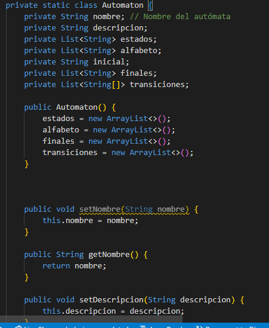
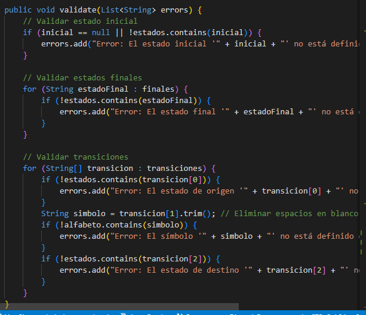
## Explicación Detallada de la Clase `Automaton`

La clase `Automaton` está diseñada para representar un autómata finito determinista. Este autómata puede ser utilizado para aceptar cadenas de caracteres conforme a ciertas reglas. A continuación se proporciona una explicación detallada de cada parte de la clase.

### Atributos

- **`String nombre`**
  - **Descripción:** Almacena el nombre del autómata.
  - **Propósito:** Este atributo sirve para identificar al autómata de forma única. Es útil cuando se maneja múltiples autómatas en un mismo sistema.

- **`String descripcion`**
  - **Descripción:** Contiene una breve descripción del autómata.
  - **Propósito:** Proporciona información adicional sobre el autómata, como su propósito o su comportamiento.

- **`List<String> estados`**
  - **Descripción:** Es una lista que contiene todos los estados posibles del autómata.
  - **Propósito:** Representa las configuraciones o posiciones en las que el autómata puede encontrarse durante su ejecución.

- **`List<String> alfabeto`**
  - **Descripción:** Es una lista que contiene todos los símbolos que forman el alfabeto del autómata.
  - **Propósito:** Define el conjunto de caracteres o símbolos que el autómata puede leer y procesar durante su ejecución.

- **`String inicial`**
  - **Descripción:** Almacena el estado inicial del autómata.
  - **Propósito:** Es el estado desde el cual el autómata comienza su ejecución cuando recibe una cadena de entrada.

- **`List<String> finales`**
  - **Descripción:** Es una lista que contiene los estados finales del autómata.
  - **Propósito:** Representa los estados de aceptación del autómata, es decir, los estados en los cuales el autómata acepta una cadena procesada.

- **`List<String[]> transiciones`**
  - **Descripción:** Contiene las transiciones del autómata, donde cada transición está representada por un arreglo de tres elementos:
    - **Estado de origen**
    - **Símbolo de transición**
    - **Estado de destino**
  - **Propósito:** Define cómo el autómata se mueve entre sus estados cuando lee un símbolo del alfabeto. Cada transición se describe como un cambio de estado basado en un símbolo.

