## UNIVERSIDAD DE SAN CARLOS DE GUATEMALA
### FACULTAD DE INGENIERÍA
#### LENGUAJES FORMALES Y DE PROGRAMACIÓN
#### CATEDRÁTICO: Ing. Zulma Karina Aguirre Ordoñez
#### TUTOR ACADÉMICO: Jonatan Leonel García Arana

#### Angel José Cardenas Pocón
#### CARNÉ: 202304063
#### SECCIÓN: B-

#### Guatemala, 3 de mayo del 2025

# Manual Técnico - Generador Visual de Mapas Narrativos 

## 1. Introducción
Este manual técnico describe el desarrollo de un sistema de análisis léxico y sintáctico en Java, orientado a procesar archivos .txt que representan mundos virtuales. El sistema identifica tokens, valida estructuras gramaticales y reporta errores con su respectiva ubicación. Además, permite visualizar gráficamente los mundos usando Graphviz. Todo fue implementado manualmente para reforzar conceptos clave de lenguajes formales y teoría de compiladores, integrando una interfaz gráfica que facilita la interacción del usuario.

---

## 2. Objetivos del Sistema

### **Objetivo General**
Diseñar e implementar desde cero un sistema de análisis léxico y sintáctico para archivos .txt, integrando las fases fundamentales de un compilador en una aplicación funcional con interfaz gráfica y capacidad de visualización de resultados.
### **Objetivos Específicos**
1. Construir un analizador léxico manual capaz de recorrer un archivo .txt caracter por caracter, identificando tokens válidos como palabras reservadas, identificadores, símbolos especiales y cadenas de texto.

2. Diseñar un analizador sintáctico descendente recursivo, que valide la estructura jerárquica del lenguaje .txt y detecte errores de construcción como elementos fuera de lugar o estructuras incompletas.

3. Registrar y clasificar errores léxicos y sintácticos, especificando el tipo de error, su ubicación (línea y columna) y permitiendo su visualización en tiempo real.

---

## 3. Requisitos del Sistema

### **3.1. Requisitos de Software**
- **Sistema Operativo:** Windows, macOS o Linux.
- **Java Development Kit (JDK):** Versión 8 o superior.
- **Editor de Código o IDE recomendado:** IntelliJ IDEA, Eclipse o Visual Studio Code.
- **Herramienta de compilación:** Javac (incluido en el JDK).
- **Navegador Web:** Para visualizar el reporte HTML generado.

### **3.2. Requisitos de Hardware**
- **Procesador:** Mínimo Intel Core i3 / AMD Ryzen 3 o superior.
- **Memoria RAM:** 4 GB mínimo (8 GB recomendado para un mejor rendimiento).
- **Almacenamiento:** 100 MB de espacio disponible para archivos y logs.
- **Pantalla:** Resolución mínima de 1280x720.

## 4. Lògica del programa
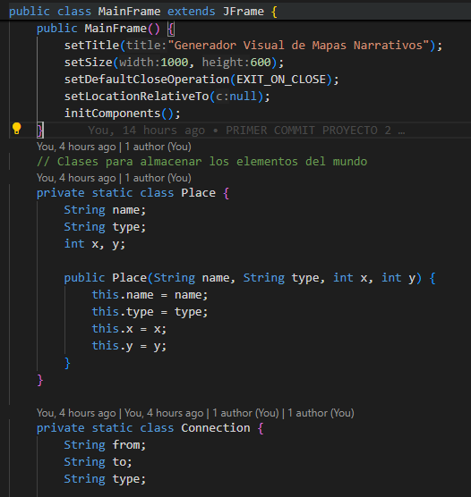
🔹 MainFrame()
Es el constructor de la ventana principal. Configura el título, tamaño, cierre del programa, posición centrada y llama a initComponents() para construir la interfaz gráfica.

🔹 Place
Clase que representa un lugar del mapa.
Atributos: name (nombre), type (tipo: jungla, templo, etc.), x, y (posición).
Se usa para ubicar visualmente los nodos del mapa.

🔹 Connection
Clase que representa una conexión entre lugares.
Atributos: from, to (lugares conectados), type (tipo de conexión: puente, sendero, etc.).
Define las líneas entre nodos en el grafo.

🔹 WorldObject
Clase que representa un objeto dentro del mundo.
Atributos: name, type (arma, trampa, etc.), location (dónde está).
Se asocia con los lugares y se representa gráficamente con íconos.
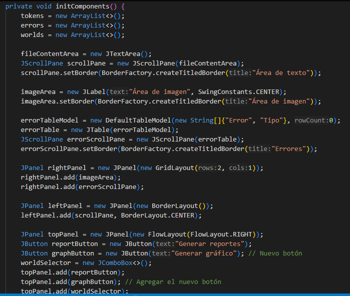

🔹 initComponents()
Este método construye y organiza todos los elementos visuales (GUI) de la aplicación:

Inicialización de datos:
tokens, errors, worlds: listas para almacenar información analizada.

Área de texto:
fileContentArea: caja de texto donde se carga el archivo.
Se agrega a un scrollPane con borde titulado.

Área de imagen:
imageArea: zona donde se mostrará el gráfico generado.
También tiene un borde con título.

Tabla de errores:
errorTableModel y errorTable: muestra los errores léxicos/sintácticos encontrados.

Paneles de organización:
leftPanel: contiene el área de texto.
rightPanel: contiene imagen y tabla de errores (en dos mitades).
centerPanel: divide la ventana entre texto e imagen/errores.

Botones:
Parte superior: reportButton, graphButton, worldSelector (combobox de mundos).
Parte inferior: loadButton, clearButton, analyzeButton.

Eventos de botones:
loadButton: carga un archivo.
clearButton: limpia el área de texto.
analyzeButton: ejecuta el análisis.
reportButton: genera reportes de tokens y errores.
graphButton: genera el gráfico del mundo seleccionado en el combo.
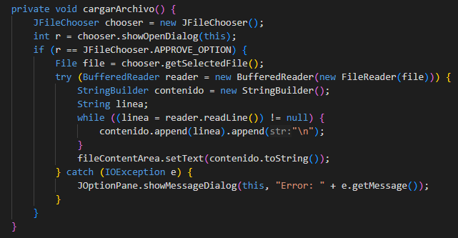
cargarArchivo()
Este método permite seleccionar y cargar un archivo de texto al área de edición de la interfaz.

Paso a paso:
Abre un selector de archivos (JFileChooser):
El usuario elige un archivo desde su sistema.

Si el usuario aprueba (elige un archivo):
Obtiene el archivo seleccionado.
Lee el contenido línea por línea usando BufferedReader.

Concatena el contenido:
Guarda cada línea en un StringBuilder para mantener el formato original.

Muestra el contenido:
Se inserta todo el texto leído en fileContentArea.

Manejo de errores:
Si ocurre un error de lectura, se muestra un mensaje emergente con el detalle.
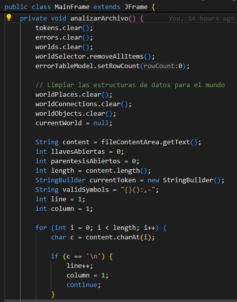
El método analizarArchivo() realiza un análisis léxico detallado del contenido cargado, identificando distintos tipos de tokens (símbolos, cadenas, identificadores, números) y detectando errores léxicos, como símbolos no válidos o desequilibrios de llaves y paréntesis.

Funcionalidad general del método:
Limpieza de estructuras anteriores:
Limpia las listas de tokens, errores, mundos y estructuras relacionadas al análisis.
Elimina ítems previos del JComboBox de mundos (worldSelector).

Configuración inicial:
Prepara el contenido para ser leído carácter por carácter.
Define caracteres válidos (validSymbols) y otras variables para control de líneas y columnas.

Análisis carácter por carácter:
Espacios y saltos de línea se omiten o actualizan línea/columna.
Símbolos válidos ({}():,-) se registran como tokens.
Cadenas entre comillas ("texto") se procesan correctamente o marcan error si están mal cerradas.
Identificadores (palabras y nombres como world) se reconocen, y si es world, se añade el siguiente string como mundo.
Números positivos y números negativos se reconocen y registran como tokens.
Símbolos inválidos generan errores.

Verificación de balanceo:
Detecta si hay llaves o paréntesis abiertos o cerrados incorrectamente.

Análisis sintáctico:
Llama al método analizarSintaxis() (probablemente definido aparte).

Resultado final:
Si no hay errores, muestra éxito en imageArea.
Si hay errores, notifica también en el área de imagen.
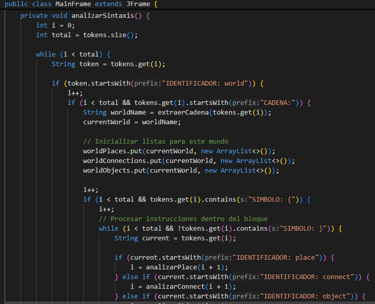
Este fragmento de código analiza la sintaxis de un bloque "world" en el lenguaje de mapas narrativos. Su objetivo es verificar que el bloque del mundo esté correctamente formado, comenzando con un nombre válido y seguido por un bloque de instrucciones dentro de llaves {}. Dentro de este bloque, también valida la presencia de elementos como "place", "connect" y "object". Si encuentra algún error de sintaxis, como símbolos faltantes o instrucciones inesperadas, genera un mensaje de error. En resumen, asegura que la estructura del mundo sea válida y coherente según las reglas del lenguaje. 
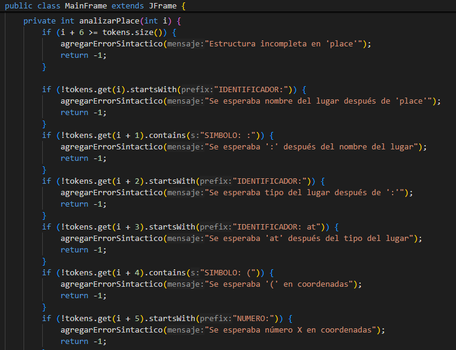
Este fragmento de código es responsable de analizar la sintaxis de un bloque "place" en el lenguaje de mapas narrativos. Aquí está el resumen:

Verificación de la Estructura: El analizador verifica que el bloque "place" tenga la estructura correcta, comprobando que los tokens estén en el orden adecuado. Si falta algún elemento, como el nombre del lugar, los dos puntos (:), las coordenadas, o cualquier otra parte esencial, se genera un error sintáctico y la función retorna -1 para indicar un fallo.

Extracción de Información: Si la estructura es válida, el analizador extrae los datos del lugar:

Nombre del lugar.

Tipo de lugar.

Coordenadas (X, Y).

Almacenamiento de Información: Si el análisis es exitoso, el lugar se guarda en la lista de lugares del mundo actual, representado por un objeto Place.

Retorno: La función retorna el índice siguiente al último token procesado para que el análisis continúe correctamente.
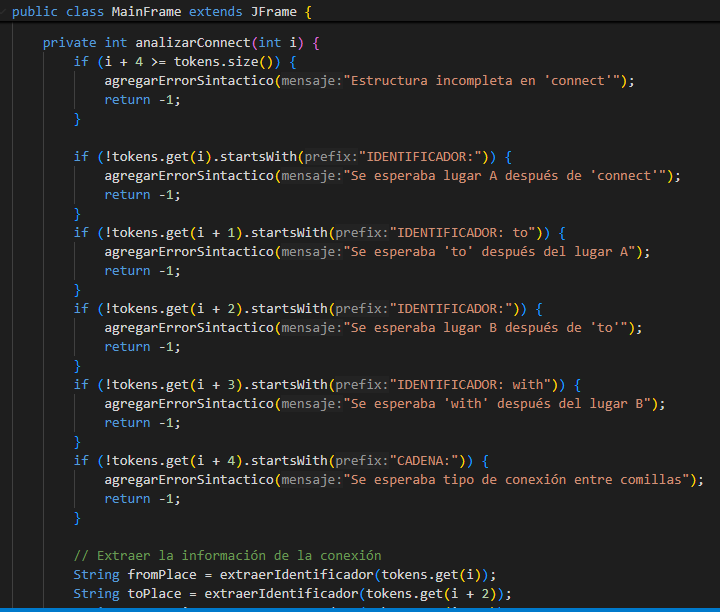
Este fragmento de código es responsable de analizar la sintaxis de un bloque "connect" en el lenguaje de mapas narrativos. Aquí tienes un resumen:

Verificación de la Estructura: El analizador revisa que el bloque "connect" tenga la secuencia correcta de tokens. Se aseguran de que se indique el lugar A, el conector "to", el lugar B, el conector "with", y finalmente, el tipo de conexión entre comillas. Si algún elemento falta o está en el orden incorrecto, se genera un error sintáctico y la función retorna -1.

Extracción de Información: Si la estructura es válida, el analizador extrae los siguientes datos:

Nombre del lugar A (origen).

Nombre del lugar B (destino).

Tipo de conexión (una cadena entre comillas).

Almacenamiento de Información: Una vez extraídos los datos, el analizador crea una nueva conexión entre los lugares A y B con el tipo de conexión y la guarda en la lista de conexiones del mundo actual.

Retorno: La función retorna el índice del siguiente token que debe procesarse para continuar el análisis.
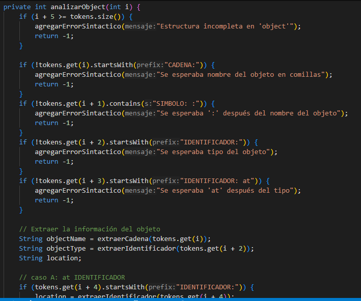
Este fragmento de código analiza la sintaxis de un bloque "object" en el lenguaje de mapas narrativos. A continuación, un resumen:

Verificación de la Estructura: El analizador revisa que el bloque "object" tenga la estructura correcta, comprobando que el nombre del objeto esté entre comillas, seguido por los tokens correctos (dos puntos :, tipo del objeto, y "at"). Si alguno de estos elementos falta o no está en el orden adecuado, se genera un error sintáctico y la función retorna -1.

Extracción de Información: Si la estructura es válida, el analizador extrae los siguientes datos:

Nombre del objeto (una cadena entre comillas).

Tipo del objeto.

Ubicación del objeto, que puede ser de dos tipos:

Caso A: La ubicación es un identificador (lugar).

Caso B: La ubicación es una coordenada en el formato (X, Y).

Almacenamiento de Información: Dependiendo del tipo de ubicación, el analizador crea un objeto WorldObject con la información extraída y lo guarda en la lista de objetos del mundo actual.

Retorno: La función retorna el índice del siguiente token que debe procesarse para continuar el análisis
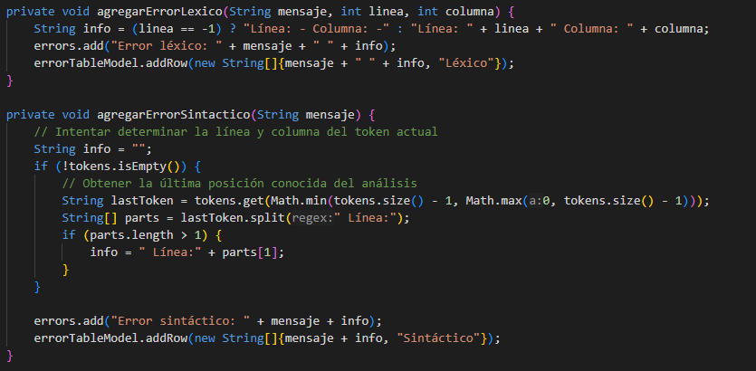
Este fragmento de código define dos métodos para agregar errores léxicos y sintácticos a una lista de errores y una tabla de errores. Aquí tienes un resumen de cada uno:

agregarErrorLexico(String mensaje, int linea, int columna):

Este método se utiliza para agregar errores léxicos al registro de errores.

Recibe un mensaje con el error, junto con la línea y columna donde ocurrió el error.

Si la línea y columna son -1 (lo que podría indicar que no se pudo determinar la posición), se muestra "Línea: - Columna: -".

El error se agrega a una lista de errores (errors) y también se agrega a un modelo de tabla (errorTableModel), que probablemente se usa para mostrar los errores en una interfaz gráfica.

agregarErrorSintactico(String mensaje):

Este método maneja los errores sintácticos, agregando un error al registro de errores.

No requiere información de línea y columna de entrada, ya que intenta determinar esta información a partir del último token procesado. Si encuentra un token, extrae la línea asociada con el token (si está presente) y la agrega al mensaje de error.

Similar al método anterior, el error se agrega a la lista de errores (errors) y al modelo de tabla (errorTableModel).
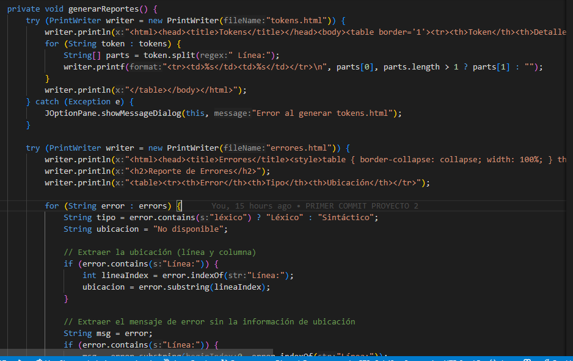
Este fragmento de código define el método generarReportes(), que crea dos archivos HTML: uno con los tokens procesados y otro con los errores encontrados. Aquí tienes un resumen de las dos secciones que contiene el método:

Generación del reporte de tokens (tokens.html):

El primer bloque de código crea un archivo HTML llamado tokens.html, el cual contiene una tabla con todos los tokens procesados.

La tabla tiene dos columnas: Token y Detalle.

Cada fila de la tabla incluye un token y su información detallada, que es extraída de la lista tokens. Si el token contiene información sobre la línea, esta también se muestra.

Si ocurre un error al escribir el archivo, se muestra un mensaje de error utilizando un cuadro de diálogo.

Generación del reporte de errores (errores.html):

El segundo bloque de código crea un archivo HTML llamado errores.html, que contiene un reporte de todos los errores (léxicos y sintácticos) que se han encontrado durante el análisis.

La tabla en este archivo tiene tres columnas: Error, Tipo (léxico o sintáctico) y Ubicación (línea y columna, si están disponibles).

Se extrae el tipo de error (léxico o sintáctico) y la ubicación del error (línea y columna), y se agregan a la tabla.

Si hay un error al generar el archivo de errores, también se muestra un cuadro de diálogo.
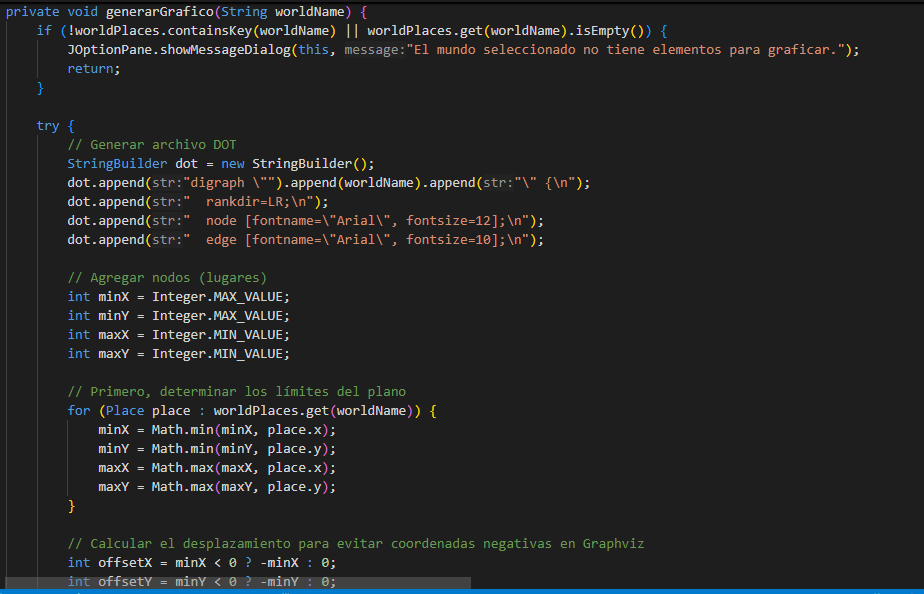
Este fragmento de código define el método generarGrafico(String worldName), el cual genera un gráfico en formato PNG utilizando Graphviz a partir de los lugares, conexiones y objetos de un mundo determinado. A continuación, te explico su funcionamiento detallado:

Explicación del Método
Verificación de existencia de datos:

Primero, verifica si el mundo (worldName) contiene elementos para graficar. Si no es así, muestra un mensaje de error.

Se revisa si la lista de lugares (worldPlaces.get(worldName)) está vacía o no existe, en cuyo caso se muestra un mensaje de alerta.

Generación del archivo DOT:

Inicio del archivo DOT: Se inicia la cadena de texto para crear el archivo DOT (un formato utilizado por Graphviz). Se especifica el tipo de gráfico (dirigido) y algunas configuraciones de estilo, como el tipo de letra y tamaño de fuente para los nodos y las aristas.

Determinación de límites del plano: Antes de agregar los nodos, se determinan los límites del plano (máximos y mínimos de las coordenadas X e Y) de todos los lugares (Place) en el mundo. Esto asegura que los lugares estén correctamente distribuidos en el gráfico y evita que aparezcan fuera de los límites.

Ajuste de coordenadas: Si las coordenadas de los lugares son negativas, se ajustan para que todas las coordenadas sean positivas y se puedan representar adecuadamente en el gráfico de Graphviz.

Agregar nodos (lugares):

Para cada lugar en el mundo (worldPlaces.get(worldName)), se determina su tipo y se asigna un estilo visual (como forma y color) utilizando el mapa tiposLugar.

Las coordenadas de los lugares se ajustan según los valores mínimos y máximos previamente calculados.

Cada lugar se agrega como un nodo en el archivo DOT, con su nombre y tipo como etiqueta.

Agregar conexiones:

Si el mundo tiene conexiones (worldConnections), se agregan como aristas (líneas que conectan nodos) en el archivo DOT. Cada conexión tiene un tipo y un estilo determinado (línea sólida o punteada, color, etc.).

Agregar objetos:

Si el mundo tiene objetos (worldObjects), se agregan como nodos adicionales con un estilo específico. Además, si el objeto está ubicado en un lugar (no en coordenadas), se agrega una conexión punteada entre el objeto y el lugar.

Guardado del archivo DOT:

Se guarda el contenido generado en un archivo DOT con el nombre graph_[worldName].dot.

Generación de imagen PNG:

Una vez guardado el archivo DOT, se ejecuta Graphviz mediante un ProcessBuilder para generar la imagen en formato PNG (graph_[worldName].png).

Si la ejecución es exitosa, se muestra la imagen en una área de imagen (con imageArea.setIcon()).

Si hay algún error durante la ejecución, se muestra un mensaje de error indicando que Graphviz no está instalado o si ocurrió algún otro problema.

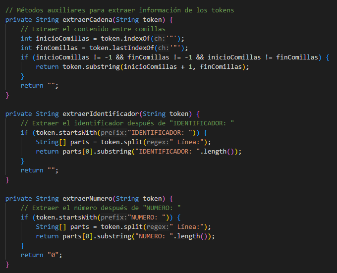
extraerCadena: Este método busca y extrae el contenido que se encuentra entre comillas en un token. Si el token contiene comillas válidas, retorna el texto dentro de ellas; si no, retorna una cadena vacía.

extraerIdentificador: Este método extrae un identificador que sigue la palabra clave "IDENTIFICADOR: " en el token. Si encuentra esta palabra clave, retorna el texto que aparece después de ella; si no la encuentra, retorna una cadena vacía.

extraerNumero: Este método busca un número que sigue la palabra clave "NUMERO: " en el token. Si encuentra esta palabra clave, retorna el número que aparece después de ella; si no, retorna "0" como valor predeterminado.

Estos métodos son útiles para procesar tokens específicos de un análisis léxico, permitiendo extraer de manera sencilla los elementos que están entre comillas, los identificadores y los números de un texto dado.
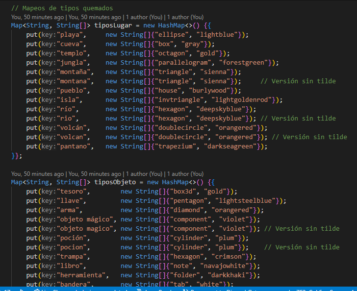
Tipos de Lugar: Se tiene un conjunto de lugares predefinidos, cada uno asociado con una forma y un color. Por ejemplo, "playa" está asociado con una forma de "elipse" y color "lightblue", mientras que "montaña" (o "montana" sin tilde) está asociado con un "triángulo" de color "sienna". Hay equivalentes para algunas palabras con y sin tilde (como "río" y "rio").

Tipos de Objeto: Similar a los lugares, los objetos también tienen una forma y un color predeterminado. Ejemplos incluyen "tesoro", que es un "caja 3D" de color "gold", y "llave", que tiene la forma de un "pentágono" con color "lightsteelblue". También se manejan versiones con y sin tilde para ciertos nombres como "objeto mágico" y "poción".

Tipos de Conexión: Las conexiones entre lugares u objetos también tienen un tipo de línea y color. Por ejemplo, "camino" tiene una línea "sólida" de color "negro", mientras que "puente" tiene una línea "puntuada" de color "gris". Además, hay equivalentes para las versiones con y sin tilde, como "teleférico" y "teleferico".

## Gramatica libre del contexto y AFD
### AFD
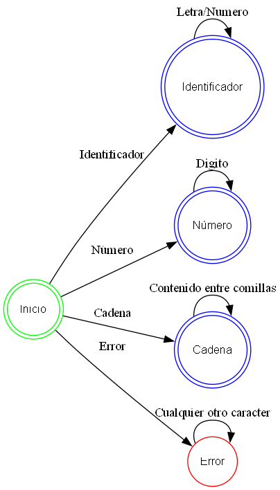
## Gramatica libre del contexto
### Símbolos no terminales:
1. S: símbolo inicial
2. LUGARES: lista de lugares
3. LUGAR: definición de un lugar
4. CONEXIONES: lista de conexiones
5. CONEXION: definición de una conexión
6. OBJETOS: lista de objetos
7. OBJETO: definición de un objeto
8. TIPO_LUGAR: tipo de lugar (e.g., playa, cueva)
9. TIPO_OBJETO: tipo de objeto (e.g., tesoro, arma)
10. UBICACION: ubicación del objeto
11. ID: identificador
12. NUM: número
### Producciones: 
1. S → world '{' LUGARES '}' connect CONEXIONES object OBJETOS

2. LUGARES → LUGAR LUGARES
3. LUGARES → LUGAR

4. LUGAR → place ID TIPO_LUGAR '(' NUM ',' NUM ')'
5. TIPO_LUGAR → playa | cueva | templo | jungla | montaña | montana | pueblo | isla | río | rio | volcán | volcan | pantano

6. CONEXIONES → CONEXION CONEXIONES
7. CONEXIONES → CONEXION

8. CONEXION → connect ID ID

9. OBJETOS → OBJETO OBJETOS
10. OBJETOS → OBJETO

11. OBJETO → object ID TIPO_OBJETO UBICACION
12. TIPO_OBJETO → tesoro | llave | arma | objeto mágico | objeto magico | poción | pocion | trampa | libro | herramienta | bandera | gema

13. UBICACION → ID
14. UBICACION → '(' NUM ',' NUM ')'

15. ID → cadena de letras y/o números sin comillas
16. NUM → dígitos numéricos
